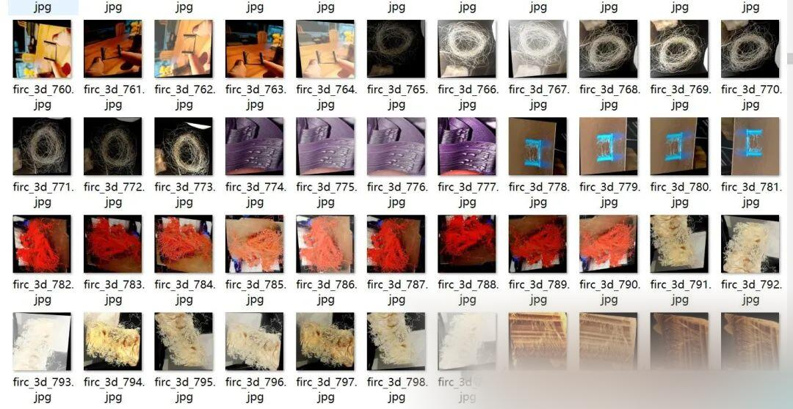
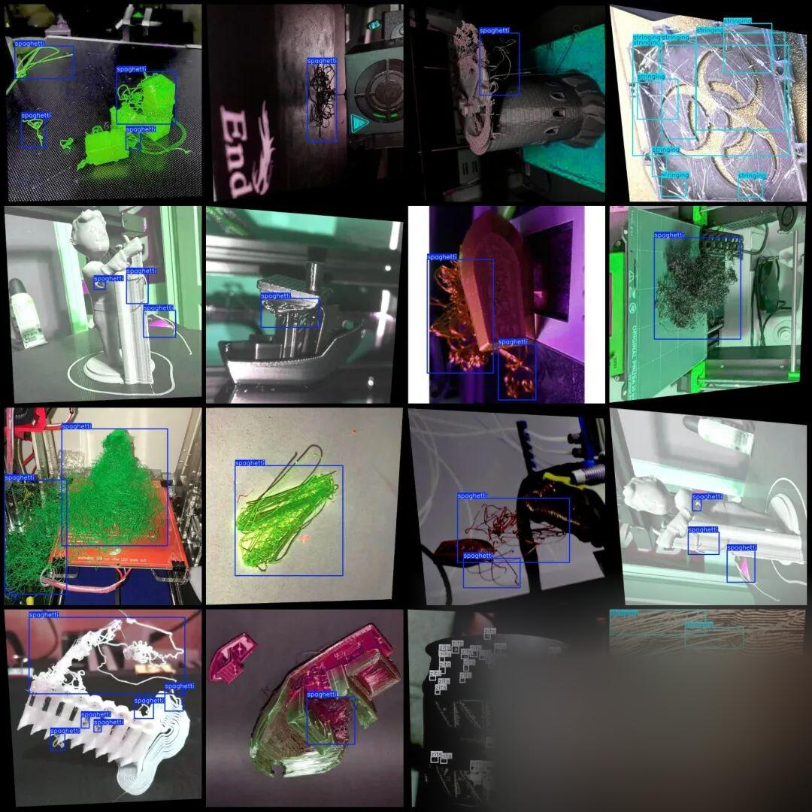

# 3D Printing Defects Detection Dataset in VOC+YOLO format with 5864 images in 3 categories

The dataset is approximately 1/3 original images, with the remaining being enhanced images. Please carefully review the image previews.

Dataset format: Pascal VOC format + YOLO format (txt file without split path, only containing jpg images and corresponding VOC format xml files and yolo format txt files)

Number of images (number of jpg files): 5864

Number of annotations (number of xml files): 5864

Number of annotations (number of txt files): 5864

Label category count: 3

Label category names (note that the order of yolo format categories does not correspond to this, but is based on the classes.txt in the labels folder): ["spaghetti", "stringing", "zits"]

Number of boxes labeled in each category:

Spaghetti frame count = 9339

Number of stringing frames = 2353

zits Frames = 30427

Total frame count: 42119

Using labelImg:

Annotation rules: Draw a rectangle around the category.

Important Notice: No

Special : This dataset does not guarantee the accuracy or precision of the trained models or weight files. The dataset is provided with accurate and reasonable annotations only.

Image Preview:

Annotation example:

## Payment

Here is a pay link on Stripe ( https://buy.stripe.com/3cs8yP7sY87d0vu9AB ). Please contact me lonlonago@foxmail.com after funding $89, and I will send you a complete data files , thank you!

